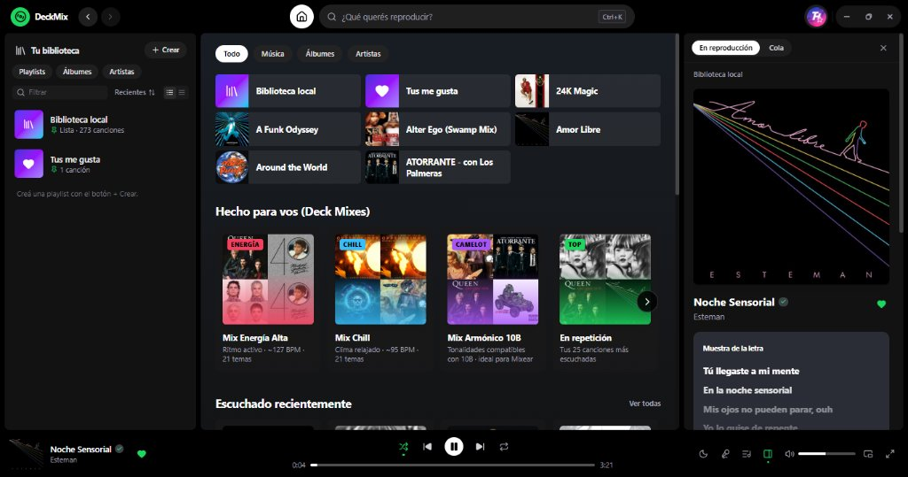
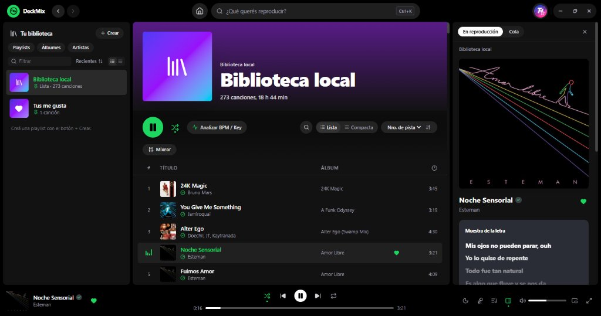
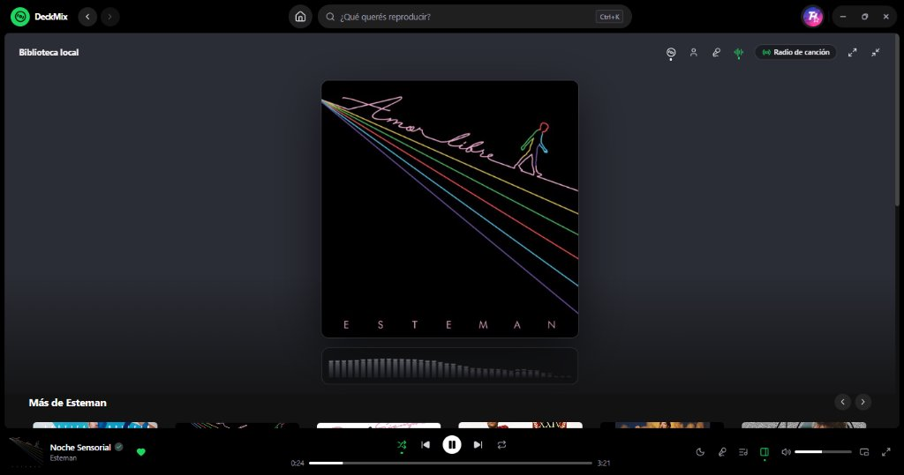
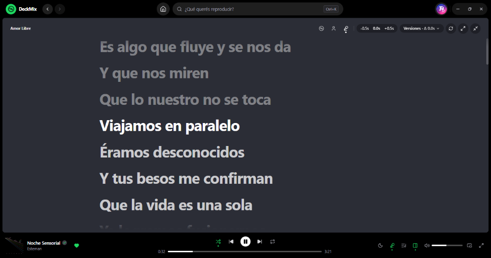

[Read in English](./README.md)

# DeckMix Player Desktop

**DeckMix Player Desktop** es un reproductor de música local rápido y 100 % offline para Windows (10/11 de 64 bits), optimizado para funcionar con fluidez incluso en PCs de 4 GB de RAM. Reúne reproducción local instantánea, integración nativa con Windows, letras sincronizadas, análisis musical automático y un Modo Mix DJ de doble deck en una única aplicación portable creada por **Thizi04**.

> **Reproductor local independiente:** DeckMix Player Desktop es un reproductor de música local independiente. No requiere cuentas, servicios en la nube ni conexión a internet para reproducir tu música; tus archivos permanecen siempre en tu PC.
>
> **Idioma:** Interfaz bilingüe en **English** y **Español** (se autodetecta al iniciar por primera vez y podés cambiarla cuando quieras desde **Configuración**).

## Descarga e inicio rápido

1. Entrá a la sección **Releases** de este repositorio y descargá **`DeckMix-Player-Portable-1.0.0-x64.exe`**.
2. Guardá el `.exe` donde prefieras (tu Escritorio, una carpeta dedicada o un pendrive) y abrilo con doble clic — sin instalación, sin Node.js ni Chrome.
3. Vinculá una o más carpetas de música desde la app para empezar a escuchar al instante.

### Modo 100 % portable (`DeckMix-Data`)

Al abrir el ejecutable portable, DeckMix crea automáticamente una carpeta visible llamada **`DeckMix-Data`** junto al `.exe`. Toda tu configuración, índice de biblioteca, playlists, historial de escucha, caché y datos de sesión se guardan dentro de `DeckMix-Data` sin ensuciar `%APPDATA%`. Para mover o respaldar tu instalación solo necesitás copiar el ejecutable junto con `DeckMix-Data`.

### Aviso de Windows SmartScreen

Al tratarse de un proyecto independiente distribuido sin firma comercial de código, Windows Defender SmartScreen puede mostrar el aviso "Windows protegió tu PC" la primera vez que lo ejecutes. Para abrirlo, hacé clic en **Más información** y luego en **Ejecutar de todas formas**.

### Requisitos

- **Sistema operativo:** Windows 10 o Windows 11 (64 bits / x64).
- **FFmpeg (opcional):** No es necesario para reproducir música, analizar tu biblioteca ni exportar mezclas en WAV. Instalar FFmpeg (o indicar su ruta en **Configuración**) solo es necesario si querés exportar mezclas a **MP3** o **FLAC**, editar metadatos directamente en los archivos de disco o usar análisis DSP asistido por FFmpeg.

## Funcionalidades principales

### Reproducción local instantánea y motor de audio
- **Streaming local directo:** Reproduce `FLAC`, `MP3`, `WAV`, `OGG`, `M4A`, `MP4`, `AAC`, `OPUS` y `WEBM` directo desde disco con inicio casi instantáneo y muy bajo consumo de memoria, manteniendo ágiles incluso bibliotecas FLAC pesadas en equipos de 4 GB de RAM.
- **Crossfade, Gapless y Micro-fades:** Crossfade configurable (`0` a `12 s`, con `0 s` para reproducción sin pausas) más micro-fades suaves sin clics al pausar, reanudar, cambiar de tema o mover la barra de tiempo.
- **Controles Master de audio:** Ecualizador gráfico de 6 bandas con presets y bypass automático, modo Mono, Auto-Gain hacia objetivo `-11 / -14 / -18 LUFS` con limitador Master de seguridad y temporizador de apagado (Sleep Timer) con fade-out suave.

### Integración nativa con Windows y Mini reproductor sin marco
- **Interfaz desktop nativa:** Barra de título oscura personalizada con controles de ventana integrados, memoria de tamaño y posición entre monitores y soporte de pantalla completa con `F11`.
- **Controles nativos de Windows:** Icono en la bandeja del sistema (System Tray) con menú dinámico y opción de minimizar a la bandeja al cerrar, botones multimedia reactivos en la vista previa de la barra de tareas (Me gusta, Anterior, Reproducir/Pausar, Siguiente), barra de progreso en el icono durante escaneos/análisis/exportaciones, Jump List nativa de Windows, atajos globales configurables, prevención de suspensión durante la reproducción, inicio opcional con Windows (incluyendo arranque oculto) y asociación de archivos `"Abrir con DeckMix"`.
- **Mini reproductor sin marco:** Ventana flotante siempre visible con reapertura instantánea y 3 modos adaptativos según su tamaño — barra compacta, portada grande con color dinámico y controles al pasar el mouse, y fila de reproducción interactiva con ajustes integrados y control de volumen.

### Modo Mix DJ y soporte de hardware
- **Modo Mix de doble deck:** Activable de forma independiente por playlist, álbum, Tus me gusta o biblioteca, con doble forma de onda RGB con zoom, grilla de beats/compases y edición directa de curvas para Volumen, EQ de 3 bandas, Filtros LPF/HPF y efectos paralelos (**Echo Out** sincronizado al BPM y **Reverb Wash**).
- **Herramientas avanzadas de mezcla:** Beatmatching en vivo, **Key Lock / Master Tempo**, **Key Shift** armónico (`-4` a `+4` semitonos), aislamiento vocal e instrumental **Mid/Side**, **Hot Cues (`C1`–`C4`)** persistentes y presets automáticos de transición (`Onda`, `Melt`, `Slam`).
- **Salidas de audio y controladoras MIDI DJ:** Selector de dispositivo de salida principal (parlantes, auriculares, HDMI, interfaces USB) con salida secundaria opcional para **preescucha CUE** en Modo Mix, además de soporte para **controladoras MIDI DJ** con **MIDI Learn**.

### Biblioteca inteligente, letras sincronizadas y utilidades
- **Análisis musical automático (DSP):** Detección en segundo plano de BPM, tonalidad musical y código Camelot, sonoridad LUFS, frases (`Intro`, `Drop`, `Outro`) y ondas RGB, con inicio diferido para que saltar rápido de canción siga siendo instantáneo.
- **Gestión viva de carpetas:** Vinculación de múltiples carpetas locales con detección automática de cambios en tiempo real, limpieza automática y segura de pistas individuales sin archivo dentro de carpetas conectadas (sin borrar temas de discos desconectados) más limpieza manual en Configuración, y acceso directo `"Mostrar en el Explorador de archivos"`.
- **Letras sincronizadas y vista ampliada:** Lectura prioritaria de archivos `.lrc` locales y búsqueda online en LRCLIB con validación estricta de duración, ajuste fino de sincronización, selector de versiones, tarjeta compacta con desplazamiento fluido y vista ampliada / Pantalla completa unificada con visualizador de espectro en vivo.
- **Inteligencia 100 % local y utilidades:** **Deck Mixes** automáticos, playlists automáticas por reproducciones, Radio de canción y Autoplay inteligente, orden armónico Smart Reorder, estadísticas **Wrapped** locales en un Perfil editable, Nivel de zoom visual (`70 %`–`130 %`), **Detector de duplicados** inteligente con envío opcional a la Papelera y respaldo/restauración portable en JSON.

### Extras de escritorio
- **Discord Rich Presence:** Integración nativa con estado `Listening` (silenciosa cuando Discord está cerrado).
- **Control remoto por Wi-Fi:** Servidor local opcional protegido con PIN e interfaz web móvil oscura para controlar la reproducción desde tu celular o TV en la misma red.
- **Exportación de mezclas y editor de tags en disco:** Exportación offline de transiciones individuales o playlists mixeadas completas a **WAV** (integrado) o **MP3 / FLAC** (con FFmpeg opcional), además de edición nativa de metadatos directamente en el archivo (título, artista, álbum, portada, BPM y tonalidad).

## Capturas de pantalla

Las siguientes imágenes son capturas de ejemplo de cómo se ve DeckMix una vez cargada una biblioteca local de música (la aplicación no incluye archivos de audio).

### Inicio y Deck Mixes

### Biblioteca local

### Vista ampliada (escenario de portada)

### Letras sincronizadas

## Historial de cambios

Consultá [CHANGELOG.es.md](./CHANGELOG.es.md) para ver el historial completo de versiones y las novedades de la v1.0.0.

## Licencia

- **Licencia:** DeckMix Player Desktop es software gratuito de código cerrado únicamente para uso personal y no comercial (**Todos los derechos reservados**, Copyright (c) 2026 Thizi04). Consultá [LICENSE.es.md](./LICENSE.es.md) para ver los términos completos.

## ¿Buscás un reproductor para Android?

DeckMix Player Desktop está pensado para PCs con Windows. Si querés un reproductor liviano, sin anuncios y con diseño OLED para tu celular, probá **[Rune](https://github.com/RSDT-s/Rune)** ([sitio web](https://rsdt-s.github.io/Rune/)), un proyecto hermano para Android hecho en Kotlin y Jetpack Compose.
