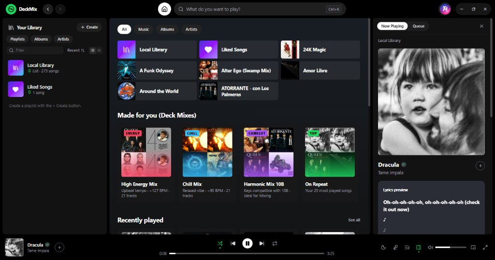
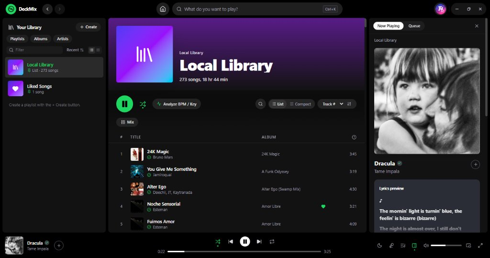
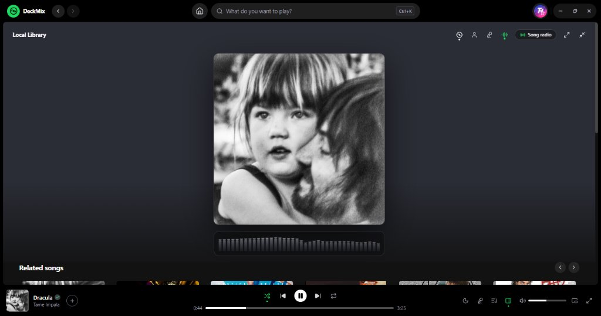
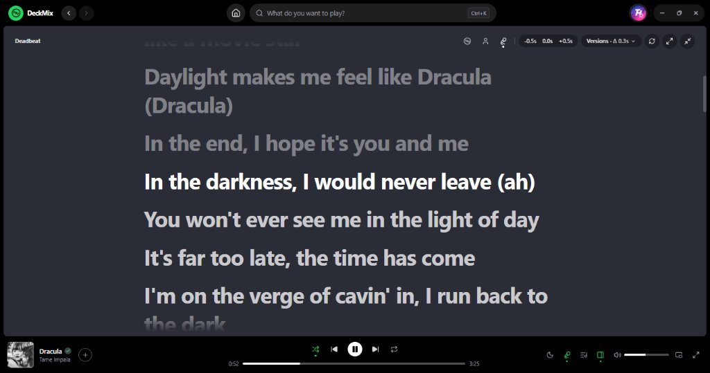

[Leer en español](./README.es.md)

# DeckMix Player Desktop

**DeckMix Player Desktop** is a fast, 100% offline local music player for Windows (10/11 64-bit), built to deliver smooth performance even on 4 GB RAM PCs. It brings together instant local audio playback, native Windows desktop integration, synced lyrics, automatic music analysis, and a built-in dual-deck DJ Mix Mode in a single portable application created by **Thizi04**.

> **Independent Local Player:** DeckMix Player Desktop is an independent local music player. It requires no accounts, no cloud services, and no internet connection to play your files; your music stays strictly on your PC.
>
> **Language:** Bilingual interface in **English** and **Español** (auto-detected on first launch and switchable anytime in **Settings**).

## Download and Quick Start

1. Go to the **Releases** section of this repository and download **`DeckMix-Player-Portable-1.0.0-x64.exe`**.
2. Place the `.exe` wherever you prefer (your Desktop, a dedicated folder, or a USB drive) and double-click to launch it — no installation, Node.js, or Chrome required.
3. Link one or more local music folders from the app to start listening right away.

### 100% Portable Mode (`DeckMix-Data`)

When you run the portable executable, DeckMix automatically creates a visible **`DeckMix-Data`** folder right next to the `.exe`. All your settings, linked library index, playlists, listening history, cache, and session data are stored inside `DeckMix-Data` without writing to `%APPDATA%`. Moving or backing up your setup is as simple as keeping the executable and `DeckMix-Data` together.

### Windows SmartScreen Notice

Because DeckMix Player Desktop is an independent project distributed without a commercial code-signing certificate, Windows Defender SmartScreen may display an "Windows protected your PC" prompt on the first launch. To open the app, click **More info** and then **Run anyway**.

### Requirements

- **Operating system:** Windows 10 or Windows 11 (64-bit / x64).
- **FFmpeg (optional):** Not required for playback, DSP analysis, or WAV mix export. Installing FFmpeg (or pointing to its executable in **Settings**) is only needed if you want to export mixes to **MP3** or **FLAC**, edit metadata tags directly inside audio files on disk, or enable FFmpeg-assisted DSP decoding.

## Key Features

### Instant Local Streaming and Audio Engine
- **Instant local streaming playback:** Plays `FLAC`, `MP3`, `WAV`, `OGG`, `M4A`, `MP4`, `AAC`, `OPUS`, and `WEBM` directly from disk with near-instant startup and low memory usage, keeping even Hi-Res FLAC libraries responsive on 4 GB RAM machines.
- **Crossfade, Gapless, and Micro-Fades:** Configurable crossfade (`0` to `12 s`, with `0 s` for seamless gapless playback) plus smooth zero-click micro-fades when pausing, resuming, skipping tracks, or seeking.
- **Master Audio Controls:** 6-band graphic equalizer with presets and automatic bypass, Mono audio mode, Auto-Gain targeting `-11 / -14 / -18 LUFS` with a Master safety limiter, and a Sleep Timer with gentle fade-out.

### Native Windows Integration and Frameless Mini Player
- **Native desktop shell:** Custom dark title bar with integrated window controls, multi-monitor window size and position memory, and `F11` fullscreen support.
- **Windows desktop controls:** System Tray icon with dynamic menu and optional minimize-to-tray on close, reactive taskbar thumbnail buttons (Like, Previous, Play/Pause, Next), taskbar icon progress indicator during scans/analysis/exports, native Windows Jump List, configurable global keyboard shortcuts, sleep prevention while playing, optional launch at Windows startup (including start-hidden), and `"Open with DeckMix"` file associations.
- **Frameless Mini Player:** Always-on-top floating window with instant reopening and 3 adaptive modes depending on window size — compact bar, large cover with dynamic accent tint and hover controls, and an interactive play queue with integrated settings and volume control.

### DJ Mix Mode and Hardware Support
- **Dual-deck Mix Mode:** Toggleable per playlist, album, Liked Songs, or library, featuring zoomable dual RGB frequency waveforms, beat/bar grids, and direct curve editing for Volume, 3-band EQ, LPF/HPF Filters, and parallel FX (BPM-synced **Echo Out** and **Reverb Wash**).
- **Pro mixing tools:** Live beatmatching, **Key Lock / Master Tempo**, harmonic **Key Shift** (`-4` to `+4` semitones), **Mid/Side** vocal and instrumental isolation, persistent **Hot Cues (`C1`–`C4`)**, and smart automatic transition presets (`Wave`, `Melt`, `Slam`).
- **Audio outputs and MIDI DJ controllers:** Primary output device selector (speakers, headphones, HDMI, USB interfaces) with optional secondary **CUE pre-listening** output in Mix Mode, plus **MIDI DJ controller** support with **MIDI Learn**.

### Smart Local Library, Synced Lyrics, and Utilities
- **Automatic music analysis (DSP):** Background detection of BPM, musical key and Camelot wheel code, LUFS loudness, song phrases (`Intro`, `Drop`, `Outro`), and RGB waveforms, with smart deferral so rapid track skipping stays instant.
- **Live folder management:** Link multiple local folders with automatic background file watching, safe automatic cleanup of missing individual tracks from connected folders (leaving unplugged drives untouched) plus manual cleanup in Settings, and direct `"Show in File Explorer"` access.
- **Synced lyrics and expanded stage:** Priority loading of local `.lrc` files and online LRCLIB search with strict duration matching, fine timing offset controls, version picker, smooth compact lyrics preview card, and unified Theater / Fullscreen stage view with a live frequency spectrum visualizer.
- **100% local discovery and utilities:** Automatic **Deck Mixes**, play-based auto-updating playlists, Song Radio and smart Autoplay, harmonic Smart Reorder, local **Wrapped** listening stats in an editable Profile, visual Zoom level (`70 %`–`130 %`), smart **Duplicate Detector** with optional send-to-Recycle-Bin cleanup, and full portable JSON backup and restore.

### Desktop Extras
- **Discord Rich Presence:** Native `Listening` activity integration (silent when Discord is closed).
- **Wi-Fi Remote Control:** Optional PIN-protected local-network remote with a dark mobile web interface for phones or TVs.
- **Mix export and disk tag editor:** Offline export of single transitions or full mixed playlists to **WAV** (built-in) or **MP3 / FLAC** (with optional FFmpeg), plus direct on-disk metadata editing for title, artist, album, cover art, BPM, and key.

## Screenshots

The images below are sample screenshots showing DeckMix after loading a local music library (no audio files are distributed with the application).

### Home and Deck Mixes

### Local Library

### Expanded Stage View

### Synced Lyrics

## Changelog

See [CHANGELOG.md](./CHANGELOG.md) for the full version history and v1.0.0 release notes.

## License

- **License:** DeckMix Player Desktop is free closed-source software for personal, non-commercial use (**All Rights Reserved**, Copyright (c) 2026 Thizi04). See [LICENSE.md](./LICENSE.md) for full terms.

## Looking for an Android Music Player?

DeckMix Player Desktop is built for Windows PCs. If you want a lightweight, ad-free OLED music player for Android, check out **[Rune](https://github.com/RSDT-s/Rune)** ([website](https://rsdt-s.github.io/Rune/)), a companion community project built with Kotlin and Jetpack Compose.
